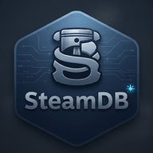

# 🚂 SteamDB Android Client

<p align="center">
  
</p>

<p align="center">
  <b>An unofficial, open-source, modern native Android client for SteamDB.</b><br>
  Browse sales, track upcoming releases, calculate game prices in TF2 keys, and consult the sacred Gaben Oracle!
</p>

<p align="center">
  <a href="https://github.com/Androo45/SteamDB-Android/releases/latest"></a>
  <a href="https://github.com/Androo45/SteamDB-Android/blob/main/LICENSE"></a>
  <a href="https://android-arsenal.com/api?level=26"></a>
  <a href="https://kotlinlang.org/"></a>
</p>

---

## 🌟 What's New in v1.0.9

- ⭐ **Favorites & Price Watch:** Star any game from its details page, lists, or the calendar. Set a target price to get instant **«▼ PRICE DROP!»** and **«🎯 TARGET REACHED!»** badges. Data persists locally on your device.
- 📅 **Redesigned Release Calendar:** Steam-style swipeable day strip with release counts and today's highlight. Pinned sticky headers as you scroll through upcoming titles, pre-order prices, and cover art.
- 🔑 **Key Commander (TF2 Keys Calculator):** Calculate how many Mann Co. Supply Crate Keys you need to buy any game using live Steam Community Market prices across **39 official currencies**. Includes 15% market fee breakdown (5% Steam + 10% TF2) and manual price fallback.
- 🔮 **Gaben Oracle:** Not sure if you should buy a game or save your money? Let the sacred coin flip decide with dynamic verdicts featuring the game's name.
- 🔔 **Update Notifier:** Built-in alert system to let you know when a newer version drops on GitHub Releases.

---

## 📱 Screenshots

*(Add your app screenshots here in a clean grid or row to showcase the UI)*
<!-- 
<p align="center">
  
  
  
</p>
-->

---

## 🛠️ Tech Stack & Architecture

- **Language:** [Kotlin](https://kotlinlang.org/)
- **UI Toolkit:** [Jetpack Compose](https://developer.android.com/jetpack/compose) (Modern, declarative UI)
- **Architecture:** MVVM (Model-View-ViewModel) pattern
- **Network / Data:** Steam Community Market live APIs & custom scraping utilities
- **Build System:** Gradle (Kotlin DSL)

---

## 🚀 Getting Started & Installation

1. Head over to the [Releases Page](https://github.com/Androo45/SteamDB-Android/releases/latest).
2. Download the latest `app-debug.apk` or `app-release.aab`.
3. Install it on your Android device (API 26 or higher).

### Building from Source

If you want to compile it locally or contribute:

```bash
git clone [https://github.com/Androo45/SteamDB-Android.git](https://github.com/Androo45/SteamDB-Android.git)
cd SteamDB-Android
# Open in Android Studio or build via terminal using Gradle wrapper
./gradlew assembleDebug
