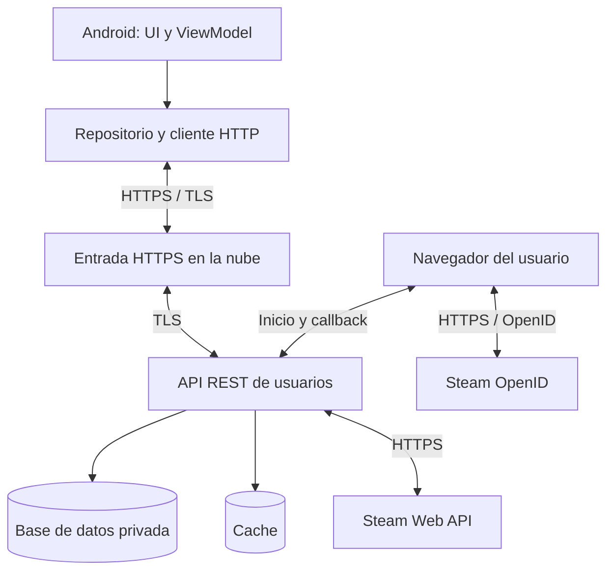
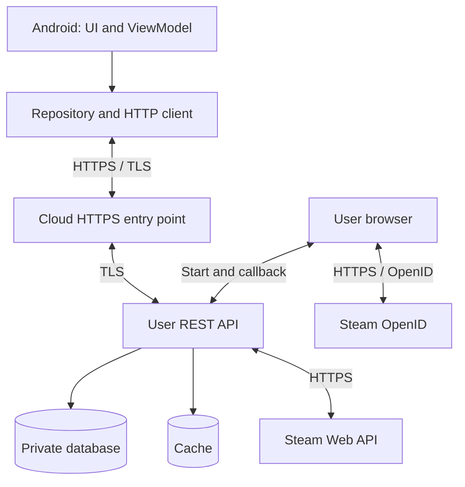

<style>
@page {
  size: A4;
  margin: 20mm 18mm;
  @bottom-right { content: counter(page); font: 9pt Arial, sans-serif; color: #64748b; }
}
body { font-family: Arial, sans-serif; line-height: 1.6; color: #1e293b; }
h1, h2, h3 { color: #173d63; break-after: avoid; }
h2 { border-bottom: 1px solid #cbd5e1; padding-bottom: 0.3em; }
img { display: block; max-width: 100%; max-height: 180mm; object-fit: contain; margin: 1em auto; break-inside: avoid; }
pre { padding: 1em; background: #f1f5f9; border-left: 3px solid #173d63; white-space: pre-wrap; overflow-wrap: anywhere; break-inside: avoid; }
.cover { box-sizing: border-box; height: 250mm; display: flex; flex-direction: column; justify-content: center; text-align: center; break-inside: avoid; }
.cover .subject { margin: 0 0 6mm; font-size: 14pt; letter-spacing: 3px; text-transform: uppercase; color: #173d63; }
.cover h1 { margin: 0 0 12mm; font-size: 34pt; line-height: 1.2; }
.cover img { width: 100%; height: auto; max-height: 110mm; margin: 0 auto 14mm; }
.cover .author { margin: 0; font-size: 14pt; }
.cover .course { margin: 3mm 0 0; font-size: 11pt; color: #64748b; }
.page-break { page-break-after: always; break-after: page; }
@media print { a { color: inherit; text-decoration: none; } }
</style>

<div class="cover">
  <p class="subject">Seguridad</p>
  <h1>SteamDB Android<br>API, Steam y nube<br>API, Steam and cloud</h1>
  
  <p class="author">Miguel Ángel García Cortés</p>
  <p class="course">2ASIR · Curso 2026–2027</p>
</div>

<div class="page-break"></div>
# Índice / Contents

- [1. Español](#espanol)
- [2. English](#english)
- [3. Referencias / References](#references)

<div class="page-break"></div>

<a id="espanol"></a>

## 1. Español

### 1.1. Objetivo y alcance

Propuesta conceptual para ampliar SteamDB Android con una API REST de usuarios, comunicación HTTPS/TLS, verificación de cuentas de Steam y alojamiento en la nube. El README del proyecto describe Kotlin y arquitectura MVVM. Las rutas y los componentes siguientes son propuestas, no funcionalidades cuya implementación se haya comprobado.

TLS significa Transport Layer Security y es el acrónimo correcto para la protección del transporte.

### 1.2. Arquitectura



El ViewModel coordina las acciones y el repositorio encapsula las peticiones. El backend valida la sesión y los permisos, accede a la base de datos y realiza las consultas a Steam. El móvil nunca accede directamente a la base de datos.

### 1.3. API de usuarios

Dominio ilustrativo: `https://api.example.com`. Las siguientes rutas pertenecen a la API propuesta del proyecto, no a Steam.

| Método | Ruta | Función | Acceso |
| --- | --- | --- | --- |
| POST | `/auth/register` | Crear una cuenta local | Público con límites |
| POST | `/auth/login` | Validar credenciales | Público con límites |
| POST | `/auth/refresh` | Renovar acceso | Token de renovación |
| POST | `/auth/logout` | Revocar la renovación | Sesión válida |
| GET | `/users/me` | Consultar perfil propio | Token de acceso |
| POST | `/auth/steam/start` | Iniciar vinculación | Token de acceso |
| GET | `/auth/steam/callback` | Validar retorno OpenID | Transacción pendiente válida |
| GET | `/users/me/steam` | Consultar perfil vinculado | Token de acceso |
| DELETE | `/users/me/steam` | Desvincular Steam | Sesión y reautenticación |

El usuario envía sus credenciales por HTTPS. El servidor compara la contraseña con un hash seguro con sal, por ejemplo Argon2id, y emite un token de acceso de corta duración y un token de renovación rotatorio. Las peticiones privadas utilizan:

```http
GET /users/me HTTP/1.1
Host: api.example.com
Authorization: Bearer <access_token>
Accept: application/json
```

La API valida el token, su caducidad y los permisos sobre cada recurso. Cerrar sesión revoca la renovación; un token de acceso emitido puede seguir vigente hasta caducar salvo que se implemente revocación inmediata. Android protege los tokens almacenados mediante claves gestionadas con Android Keystore y los excluye de registros y copias de seguridad.

### 1.4. Verificación de Steam y consulta REST

**Steam OpenID demuestra el control de la cuenta; Steam Web API permite consultar sus datos.** Consultar un SteamID por REST no demuestra que pertenezca al usuario.

1. El usuario autenticado pulsa «Vincular Steam». El backend crea una transacción temporal ligada a su sesión.
2. Android abre el navegador para autenticar al usuario en Steam. La aplicación no recoge la contraseña de Steam.
3. Steam devuelve una respuesta al callback HTTPS del backend. Una biblioteca OpenID valida la respuesta con el proveedor, el identificador, el destino de retorno y la protección frente a repetición. El backend comprueba la correlación con la transacción iniciada.
4. El backend vincula el SteamID64 verificado a la cuenta local. No acepta un identificador enviado por el móvil como prueba de propiedad.
5. El servidor consulta el perfil mediante REST y devuelve solo los campos necesarios.
6. Un App Link verificado devuelve al usuario a Android. Si se necesita completar la sesión, se usa un código de un solo uso ligado a la transacción, sin incluir tokens de sesión en la URL.

Consulta de perfil ejecutada únicamente desde el backend:

```text
GET https://api.steampowered.com/ISteamUser/GetPlayerSummaries/v0002/?key=<SERVER_API_KEY>&steamids=<VERIFIED_STEAMID64>
```

Permite obtener datos disponibles de perfil, como nombre y avatar. Las restricciones de privacidad o campos ausentes no deben interpretarse como una identidad inválida. La clave de Steam permanece en el servidor y se oculta en los registros de URL. Véanse las referencias oficiales de Steam del apartado 3.

### 1.5. Alojamiento en la nube y consultas

Se propone una arquitectura independiente del proveedor:

| Componente | Alojamiento y responsabilidad |
| --- | --- |
| DNS y entrada HTTPS | Dominio público, certificado renovable y balanceador o proxy inverso |
| API REST | Contenedor o servicio de aplicaciones gestionado |
| PostgreSQL | Servicio gestionado en red privada para usuarios y datos propios |
| Redis opcional | Caché de consultas con caducidad configurable |
| Gestor de secretos | Clave de Steam, credenciales y material de firma |
| Operación | Métricas, registros sin secretos, alertas y copias de seguridad |

Flujo de consultas: Android envía una petición al backend, que valida la sesión. Los datos propios se consultan en PostgreSQL; para datos de Steam se revisa primero la caché. Si no hay una entrada vigente, el backend consulta Steam por HTTPS, filtra la respuesta y actualiza la caché. Las claves de caché deben incluir al usuario cuando los datos sean privados.

Las consultas SQL utilizan parámetros y una cuenta con permisos mínimos. Se aplican paginación, límites de peticiones, tiempos de espera y reintentos limitados con espera progresiva para fallos transitorios. Una caída de Steam produce una respuesta controlada; puede servirse caché anterior indicando su antigüedad. No se inventan resultados ni se modifica la vinculación de identidad por un fallo de consulta.

La base de datos no expone un puerto público. Si el balanceador termina TLS, el tramo hasta el backend también usa TLS. Las conexiones a la base de datos se cifran y validan su certificado. El despliegue contempla comprobaciones de salud, migraciones controladas, restauraciones probadas y ampliación de instancias del backend. El proveedor, la región y el tamaño se elegirán según uso y presupuesto; no se presupone un coste concreto.

### 1.6. Seguridad y validación prevista

TLS protege la confidencialidad e integridad del transporte y autentica al servidor. Los tokens identifican al usuario y la API autoriza cada operación. Se propone TLS 1.3 y TLS 1.2 cuando sea necesario por compatibilidad, con certificados válidos y renovación automática. Android debe bloquear HTTP y rechazar certificados inválidos mediante su configuración de seguridad de red.

Comprobaciones de aceptación pendientes de ejecutar cuando exista una implementación:

- Rechazo de HTTP y de certificados inválidos.
- Rechazo de tokens ausentes, modificados o caducados.
- Imposibilidad de acceder a recursos ajenos cambiando identificadores.
- Rechazo de callbacks OpenID falsificados, repetidos o sin transacción válida.
- Una consulta de un SteamID arbitrario no acredita su propiedad.
- La clave de Steam no aparece en el APK, el repositorio ni los registros.
- Respuestas controladas ante caídas o límites de Steam.
- Base de datos privada y restauración efectiva de una copia de seguridad.

<div class="page-break"></div>

### 1.7. Estado real del código revisado

Revisión estática de la rama `main`, commit `b0f0f2df5647d0a187a4c84d5bd25f4f33779628`, realizada el 19 de octubre de 2026. No se ha compilado ni ejecutado la aplicación ni comprobado la disponibilidad de sus proveedores. Las recomendaciones de este manual no modifican el proyecto.

| Archivo | Contenido observado e implicación |
| --- | --- |
| `app/src/main/java/com/example/steamdb/MainActivity.kt` | Concentra interfaz Compose, modelos, `SdbMainViewModel`, cliente de red y persistencia. Hay ViewModel, pero no una capa de repositorios independiente como la propuesta en este manual. |
| `app/build.gradle.kts` | Versión `1.1.0`, código `12`; `minSdk=26`, `targetSdk=35`, `compileSdk=35`, JVM 17. Usa Compose, Material 3, Coil y coroutines. No declara Retrofit, Ktor ni un SDK de autenticación. |
| `build.gradle.kts` | Android Gradle Plugin `8.7.2` y Kotlin/Compose `2.0.21`. |
| `settings.gradle.kts` | Un único módulo Android `:app`; no hay módulo de backend. |
| `AndroidManifest.xml` | Permiso `INTERNET`, `allowBackup=true` y una actividad de lanzamiento exportada. No declara App Links ni una configuración de seguridad de red propia. |
| `.github/workflows/build-apk.yml` | Compila `assembleDebug` con JDK 17 y publica un artefacto APK. No despliega una API ni una base de datos. |
| `README.md` y `LEEME-CAMBIOS-1.0.9.md` | Describen principalmente la versión 1.0.9; deben distinguirse del estado 1.1.0 declarado en Gradle. |
| `gradle.properties`, wrapper y recursos vectoriales | Configuración de construcción e iconos; no aportan infraestructura cloud ni autenticación. |

No se han encontrado registro, inicio de sesión, tokens, vinculación OpenID, base de datos remota ni despliegue cloud en los archivos revisados. Las pantallas existentes incluyen inicio, rankings, ofertas, favoritos, calendario, eventos, calculadora TF2, oráculo y ficha detallada de juegos.

### 1.8. Consultas y proveedores utilizados actualmente

`ValveSteamClient.getJson()` utiliza `URL.openConnection()` convertido a `HttpURLConnection`, peticiones GET, JSON procesado con `JSONObject`, y tiempos de conexión y lectura de 8 segundos. Las URL observadas usan HTTPS; el nombre de la clase base no significa que esas conexiones sean HTTP sin cifrar. No se observa código que desactive la validación de certificados. El método devuelve una cadena vacía ante errores HTTP o excepciones, por lo que pierde la causa del fallo.

| Función del código | Destino o ruta actual | Uso |
| --- | --- | --- |
| `fetchLiveSuggestions` | `store.steampowered.com/api/storesearch/` | Búsqueda con texto codificado, hasta 14 sugerencias |
| `fetchStoreCategories` | `store.steampowered.com/api/featuredcategories` | Ventas, ofertas, próximos y nuevos lanzamientos |
| `fetchTop100MostPlayedGames` | `api.steampowered.com/ISteamChartsService/GetMostPlayedGames/v1/` | Ranking, enriquecido con detalles y jugadores |
| `fetchLivePlayers` | `api.steampowered.com/ISteamUserStats/GetNumberOfCurrentPlayers/v1/` | Jugadores simultáneos por AppID |
| `fetchUpcomingCalendar` | `store.steampowered.com/search/results/` y `/api/appdetails` | Calendario y detalles de hasta 60 juegos |
| `fetchFullAppInspector` | `/api/appdetails` y `/appreviews/{appId}` de la tienda | Ficha, precios, reseñas, DLC y capturas |
| `fetchAll41SteamCurrencies` | Tienda: `/api/appdetails?appids=…&cc=…` | Una petición por cada una de las 41 entradas regionales |
| `fetchMonthlyPlayerHistory` | `steamcharts.com/app/{appId}` | Extrae HTML mediante expresiones regulares; proveedor externo |
| `fetchCommunityStats` | `steamspy.com/api.php?request=appdetails&appid=…` | Estimaciones de comunidad; proveedor externo |
| `fetchAchievementPercents` | `ISteamUserStats/GetGlobalAchievementPercentagesForApp/v0002/` | Porcentajes globales de logros |
| `fetchAppPatchNotes` | `ISteamNews/GetNewsForApp/v2/` | Noticias y notas |
| `fetchTf2KeyPrice` | `steamcommunity.com/market/priceoverview/` | Precio de llaves TF2; hasta 3 intentos y entrada manual alternativa |
| `SteamSmartThumb` | Varios dominios `steamstatic.com` | Imágenes con alternativas cargadas mediante Coil |
| `UpdateChecker` | GitHub Releases de `Androo45/SteamDB-Android` | Comprueba el proyecto original, no este fork |

Estas rutas se han extraído del código; no constituyen una garantía de disponibilidad o contrato estable. SteamCharts y SteamSpy son fuentes distintas de Valve. Los endpoints de tienda y mercado deben tener adaptadores separados de la Steam Web API para poder gestionar cambios de formato y restricciones de cada fuente.

### 1.9. Integración propuesta adaptada a esta aplicación

La evolución documentada sería `Compose → SdbMainViewModel → repositorios → API propia HTTPS → adaptadores de proveedores`. Se propone separar `UserRepository`, `GameRepository` y `FavoritesRepository`, manteniendo modelos de interfaz como `SdbGameSummary` y `SdbFullAppData` mediante un mapeo explícito. La incorporación de Retrofit u otro cliente es opcional; no es un requisito para usar TLS.

| Nueva ruta propuesta | Integración con código existente |
| --- | --- |
| `GET /v1/games/search?q=…&country=es&language=spanish` | `onTopSearchQueryChanged`, que actualmente aplica 200 ms de debounce |
| `GET /v1/home?country=es&language=spanish` | Agregado para `refreshAllSteamData`, con categorías y rankings |
| `GET /v1/games/{appId}` | Datos principales de `openAppInspector` |
| `GET /v1/games/{appId}/prices` | Matriz regional, con carga diferida y caché |
| `GET /v1/games/{appId}/stats` | Jugadores, SteamCharts, SteamSpy y logros, identificando cada fuente |
| `GET /v1/games/{appId}/news` | Notas y noticias |
| `GET /v1/market/tf2-key?currency=…` | Sustituye la consulta directa de `fetchTf2KeyPrice` |
| `GET /v1/users/me/favorites` | Recupera favoritos del usuario autenticado |
| `PUT /v1/users/me/favorites/{appId}` | Alta o actualización idempotente del objetivo |
| `DELETE /v1/users/me/favorites/{appId}` | Eliminación sincronizada |

Todas las rutas de esta tabla son nuevas propuestas. Las rutas `/auth/*` del apartado 1.3 también son propuestas y mantienen su nomenclatura. Consultar información pública no requiere vincular Steam; la sesión se exige para los datos personales. El backend obtiene el usuario del token, no de un `userId` libre enviado por el cliente. El SteamID64 se almacena como cadena decimal, y `appId` sigue identificando juegos: son identificadores diferentes.

`FavoritesStore` guarda `steamdb_favorites/favorites_json`; `PriceHistoryStore` usa `steamdb_price_history/hist_{appId}` y conserva hasta 180 puntos; `SdbSettings` guarda tema e idioma en `steamdb_settings`. Son datos locales en SharedPreferences, sin sincronización por cuenta. La migración propuesta debe importar favoritos solo con consentimiento del usuario, mantener una copia local y resolver conflictos con versiones de servidor y marcas de borrado para evitar recuperar favoritos eliminados. Los datos locales deben separarse por cuenta tras incorporar sesiones.

Modelo cloud mínimo propuesto: `users`, `steam_links` con SteamID único, `refresh_sessions`, `favorites` con clave `(user_id, app_id, country, currency)`, y `price_observations` con AppID, país, moneda, importe en unidades menores, fecha, fuente y calidad. Los favoritos pertenecen a cada usuario; las observaciones públicas pueden compartirse. El precio y el descuento se obtienen de la fuente, no se aceptan como valores oficiales enviados por el móvil. Los objetivos monetarios deben validarse y evitar conversiones imprecisas de `Double` a céntimos.

### 1.10. Limitaciones que condicionan el servicio cloud

- **Carga externa:** el código limita algunas consultas con `Semaphore(10)`, pero no todas; el inspector inicia varias tareas, incluida una matriz de 41 regiones. En la nube se necesita un límite global por proveedor, agrupación de peticiones idénticas y caché por AppID, país e idioma. Un semáforo por instancia no controla el total de un despliegue con varias réplicas.
- **Calidad de datos:** el ranking sustituye algunos valores actuales por `peak * 0.78` con mínimo 120. La ficha calcula el pico diario como `livePlayers * 1.24` y un pico histórico aproximado. La nube debe separar valores medidos y estimados, incluyendo `source`, `fetchedAt`, `estimated` y `stale`; no presentar aproximaciones como mediciones oficiales.
- **Precios y divisas:** las conversiones a euros utilizan tipos de cambio fijos en el código. No son cotizaciones en tiempo real. Las 41 entradas regionales del inspector son una lista distinta de las 39 entradas de la calculadora. La API debe conservar país y moneda original y, si convierte, indicar fuente y fecha del cambio.
- **Errores y cero:** varias funciones convierten errores en cero, listas vacías o `null`; `SdbGameSummary.isFree` interpreta ambos precios a cero como gratuito. La API debe distinguir ausencia de precio, fallo de proveedor y gratuidad real, y devolver errores tipados.
- **Historial y avisos:** el historial registra observaciones locales positivas, no un histórico completo de Steam. El umbral denominado `sameDay` utiliza 20 horas, no un día natural. Los avisos de favoritos se recalculan al actualizar o consultar fichas; no hay servicio de notificaciones push ni monitorización autónoma. Un seguimiento continuo requeriría un worker programado en la nube, deduplicación de alertas y un canal de notificación aparte.
- **Configuración:** el calendario de eventos está codificado en `SteamSalesSchedule`; no se actualiza desde una API. El cambio ES/EN afecta a textos de interfaz, pero muchas consultas siguen fijando `cc=es` y `l=spanish`. La nube debe tratar idioma, país y moneda como parámetros distintos.
- **Sesión y Android:** faltan las pantallas de cuenta y los App Links del flujo propuesto. `allowBackup=true` exige definir exclusiones para secretos al añadir tokens. La etiqueta visual `ONLINE` del menú es fija y no acredita conectividad.
- **Actualización y despliegue:** `UpdateChecker` consulta Releases del repositorio original; el User-Agent mantiene `1.0.9`, aunque Gradle y el comprobador declaran `1.1.0`. El workflow genera una APK debug; un backend necesita su propio despliegue y la distribución de producción requiere definir firma y publicación. Son tareas propuestas, no realizadas.

Como punto de partida configurable, la caché podría conservar jugadores y rankings 60 segundos, precios y mercado 5 minutos, metadatos 24 horas e históricos externos 6 horas. Son valores de diseño que deben ajustarse al uso y a las condiciones de los proveedores. El adaptador no aceptará URL arbitrarias del móvil; utilizará hosts permitidos e identificadores validados.

### 1.11. Orden de incorporación y comprobaciones específicas

1. Definir contratos JSON y errores tipados, preservando las funciones actuales sin exigir cuenta para navegar por datos públicos.
2. Desplegar API HTTPS, secretos, base de datos privada y caché; verificar permisos y aislamiento entre usuarios.
3. Incorporar sesiones y vinculación Steam con callback validado, sin almacenar credenciales Steam.
4. Sincronizar favoritos de forma idempotente y separar preferencias y datos de cada cuenta.
5. Trasladar consultas costosas a adaptadores cloud, con carga diferida de regiones y control global de tráfico.
6. Verificar búsquedas rápidas sin resultados obsoletos, respuestas parciales del inspector, diferencias de moneda, importación sin pérdidas, desconexión y caída de proveedores. Comprobar que ninguna respuesta privada queda en caché pública ni que el token propio se envía a Steam, GitHub o dominios de imágenes.

<div class="page-break"></div>

<a id="english"></a>

## 2. English

### 2.1. Purpose and scope

Conceptual proposal to extend SteamDB Android with a user REST API, HTTPS/TLS communications, Steam account verification and cloud hosting. The project README describes Kotlin and MVVM. The following routes and components are proposed additions, not verified existing functionality.

TLS stands for Transport Layer Security and is the correct transport security acronym.

### 2.2. Architecture



The ViewModel coordinates actions and the repository encapsulates requests. The backend validates sessions and permissions, accesses the database and queries Steam. The mobile app never accesses the database directly.

### 2.3. User API

Illustrative domain: `https://api.example.com`. These are proposed application routes, not Steam endpoints.

| Method | Route | Purpose | Access |
| --- | --- | --- | --- |
| POST | `/auth/register` | Create a local account | Public, rate limited |
| POST | `/auth/login` | Validate credentials | Public, rate limited |
| POST | `/auth/refresh` | Renew access | Refresh token |
| POST | `/auth/logout` | Revoke refresh session | Valid session |
| GET | `/users/me` | Retrieve own profile | Access token |
| POST | `/auth/steam/start` | Start account linking | Access token |
| GET | `/auth/steam/callback` | Validate OpenID response | Valid pending transaction |
| GET | `/users/me/steam` | Retrieve linked profile | Access token |
| DELETE | `/users/me/steam` | Unlink Steam | Session and reauthentication |

Credentials are sent over HTTPS. The server checks the password against a salted secure hash, such as Argon2id, and issues a short-lived access token and rotating refresh token. Private requests use:

```http
GET /users/me HTTP/1.1
Host: api.example.com
Authorization: Bearer <access_token>
Accept: application/json
```

The API validates the token, expiration and resource permissions. Logout revokes the refresh session; an issued access token may remain valid until expiry unless immediate revocation is implemented. Android protects stored tokens using keys managed through Android Keystore and excludes them from logs and backups.

### 2.4. Steam verification and REST queries

**Steam OpenID proves account control; Steam Web API retrieves account data.** A REST lookup of a SteamID alone does not prove ownership.

1. An authenticated user selects “Link Steam”. The backend creates a temporary transaction bound to the session.
2. Android opens the browser for Steam authentication. The app does not collect the Steam password.
3. Steam returns a response to the backend HTTPS callback. An OpenID library validates it with the provider, including the identifier, return destination and replay protection. The backend checks correlation with the pending transaction.
4. The backend links the verified SteamID64 to the local account. A mobile-supplied identifier is not accepted as proof of ownership.
5. The server queries the profile through REST and returns only necessary fields.
6. A verified App Link returns the user to Android. If session completion is needed, use a transaction-bound single-use code, without placing session tokens in the URL.

Profile query executed only by the backend:

```text
GET https://api.steampowered.com/ISteamUser/GetPlayerSummaries/v0002/?key=<SERVER_API_KEY>&steamids=<VERIFIED_STEAMID64>
```

It retrieves available profile details, such as display name and avatar. Privacy restrictions or missing fields should not be treated as invalid identity. The Steam key stays on the server and is redacted from URL logs. See the official Steam references in section 3.

### 2.5. Cloud hosting and queries

The proposed architecture is provider independent:

| Component | Hosting and responsibility |
| --- | --- |
| DNS and HTTPS entry point | Public domain, renewable certificate and load balancer or reverse proxy |
| REST API | Managed container or application service |
| PostgreSQL | Managed private-network service for users and application data |
| Optional Redis | Query cache with configurable expiration |
| Secret manager | Steam key, credentials and signing material |
| Operations | Metrics, redacted logs, alerts and backups |

Query flow: Android sends a request to the backend, which validates the session. Application data is queried in PostgreSQL; Steam data is checked in the cache first. On a cache miss, the backend calls Steam over HTTPS, filters the response and updates the cache. Cache keys must include the user where data is private.

SQL queries use parameters and a least-privilege account. Apply pagination, rate limits, timeouts and bounded retries with backoff for transient failures. Steam outages produce controlled responses; older cached data may be served if its age is disclosed. Query failures must not produce fabricated results or change identity links.

The database has no public port. If TLS terminates at the load balancer, the connection to the backend also uses TLS. Database connections are encrypted and validate the certificate. Deployment includes health checks, controlled migrations, tested restores and backend instance scaling. Choose provider, region and capacity according to usage and budget; no specific cost is assumed.

### 2.6. Security and planned validation

TLS provides transport confidentiality, integrity and server authentication. Tokens identify users and the API authorizes each operation. The proposal uses TLS 1.3 and TLS 1.2 where compatibility requires it, valid certificates and automated renewal. Android must block HTTP and reject invalid certificates through its network security configuration.

Acceptance checks to run once an implementation exists:

- HTTP and invalid certificates are rejected.
- Missing, modified and expired tokens are rejected.
- Changing identifiers does not grant access to another user's resources.
- Forged, replayed or uncorrelated OpenID callbacks are rejected.
- Looking up an arbitrary SteamID does not establish ownership.
- The Steam key is absent from the APK, repository and logs.
- Steam outages and rate limits produce controlled responses.
- The database is private and a backup can be restored successfully.

### 2.7. Actual reviewed implementation

Static review of `main`, commit `b0f0f2df5647d0a187a4c84d5bd25f4f33779628`, on 19 October 2026. The application was not built or run, and provider availability was not tested. Recommendations in this manual do not change the project.

| File | Observed content and implication |
| --- | --- |
| `app/src/main/java/com/example/steamdb/MainActivity.kt` | Contains Compose UI, models, `SdbMainViewModel`, networking and persistence. A ViewModel exists, but there is no independent repository layer as proposed here. |
| `app/build.gradle.kts` | Version `1.1.0`, code `12`; minimum SDK 26, target/compile SDK 35, JVM 17. Declares Compose, Material 3, Coil and coroutines, without Retrofit, Ktor or an authentication SDK. |
| `build.gradle.kts` | Android Gradle Plugin `8.7.2` and Kotlin/Compose `2.0.21`. |
| `settings.gradle.kts` | A single Android module, `:app`; no backend module. |
| `AndroidManifest.xml` | `INTERNET`, `allowBackup=true` and an exported launcher activity; no App Links or custom network security configuration. |
| `.github/workflows/build-apk.yml` | Runs `assembleDebug` with JDK 17 and uploads an APK artifact; does not deploy cloud services. |
| `README.md` and `LEEME-CAMBIOS-1.0.9.md` | Mainly describe 1.0.9, rather than the 1.1.0 version declared in Gradle. |
| `gradle.properties`, wrapper and vector resources | Build settings and icons, without cloud infrastructure or authentication. |

The reviewed files contain no registration, login, tokens, OpenID linking, remote database or cloud deployment. Existing screens cover home, charts, sales, favorites, release calendar, events, TF2 calculator, oracle and detailed game inspection.

### 2.8. Existing queries and providers

`ValveSteamClient.getJson()` uses `URL.openConnection()` cast to `HttpURLConnection`, GET requests, `JSONObject` parsing, and 8-second connection/read timeouts. Observed URLs use HTTPS; the base class name does not make them unencrypted HTTP. No code disabling certificate validation was observed. HTTP failures and exceptions become empty strings, losing their original cause.

| Code function | Current destination or path | Purpose |
| --- | --- | --- |
| `fetchLiveSuggestions` | Store `/api/storesearch/` | Encoded search, up to 14 suggestions |
| `fetchStoreCategories` | Store `/api/featuredcategories` | Sellers, sales and releases |
| `fetchTop100MostPlayedGames` | `ISteamChartsService/GetMostPlayedGames/v1/` | Rankings enriched with details and player counts |
| `fetchLivePlayers` | `ISteamUserStats/GetNumberOfCurrentPlayers/v1/` | Concurrent players by AppID |
| `fetchUpcomingCalendar` | Store `/search/results/` and `/api/appdetails` | Release information for up to 60 games |
| `fetchFullAppInspector` | Store `/api/appdetails` and `/appreviews/{appId}` | Details, prices, reviews, DLC and screenshots |
| `fetchAll41SteamCurrencies` | Store `/api/appdetails?appids=…&cc=…` | One request for each of 41 regional entries |
| `fetchMonthlyPlayerHistory` | `steamcharts.com/app/{appId}` | HTML extraction using regular expressions; external provider |
| `fetchCommunityStats` | `steamspy.com/api.php?request=appdetails&appid=…` | Community estimates; external provider |
| `fetchAchievementPercents` | `ISteamUserStats/GetGlobalAchievementPercentagesForApp/v0002/` | Global achievement percentages |
| `fetchAppPatchNotes` | `ISteamNews/GetNewsForApp/v2/` | News and updates |
| `fetchTf2KeyPrice` | Community `/market/priceoverview/` | TF2 key price; up to 3 attempts and manual fallback |
| `SteamSmartThumb` | Several `steamstatic.com` domains | Coil image loading with fallback URLs |
| `UpdateChecker` | GitHub Releases for `Androo45/SteamDB-Android` | Checks the upstream project, not this fork |

These paths were extracted from source, without guaranteeing availability or a stable contract. Store routes use `store.steampowered.com`, Community routes use `steamcommunity.com`, and Steam Web API routes use `api.steampowered.com`. SteamCharts and SteamSpy are separate providers. Use separate adapters for store, market and Web API requests to handle their individual format changes and restrictions.

### 2.9. Integration tailored to this application

Proposed evolution: `Compose → SdbMainViewModel → repositories → own HTTPS API → provider adapters`. Introduce `UserRepository`, `GameRepository` and `FavoritesRepository`, with explicit mapping to existing UI models such as `SdbGameSummary` and `SdbFullAppData`. Retrofit or another client is optional, not a TLS requirement.

| Proposed new route | Existing integration point |
| --- | --- |
| `GET /v1/games/search?q=…&country=es&language=spanish` | `onTopSearchQueryChanged`, currently using 200 ms debounce |
| `GET /v1/home?country=es&language=spanish` | Aggregated categories and charts for `refreshAllSteamData` |
| `GET /v1/games/{appId}` | Main data for `openAppInspector` |
| `GET /v1/games/{appId}/prices` | Regional matrix with lazy loading and caching |
| `GET /v1/games/{appId}/stats` | Players, SteamCharts, SteamSpy and achievements, with source attribution |
| `GET /v1/games/{appId}/news` | News and updates |
| `GET /v1/market/tf2-key?currency=…` | Replaces direct `fetchTf2KeyPrice` request |
| `GET /v1/users/me/favorites` | Authenticated user's favorites |
| `PUT /v1/users/me/favorites/{appId}` | Idempotent addition or target update |
| `DELETE /v1/users/me/favorites/{appId}` | Synchronized removal |

Every route in this table is a proposed addition. Proposed `/auth/*` routes in section 2.3 retain their names. Public information does not require Steam linking; personal data requires authentication. Derive the local user from the token, not a client-controlled `userId`. Store SteamID64 as a decimal string; game `appId` is a different identifier.

`FavoritesStore` uses `steamdb_favorites/favorites_json`; `PriceHistoryStore` uses `steamdb_price_history/hist_{appId}` and retains up to 180 points; `SdbSettings` stores theme and language in `steamdb_settings`. These are local SharedPreferences without account synchronization. Proposed migration should import favorites with user consent, retain a local copy, and resolve conflicts using server versions and deletion markers so removed entries do not reappear. Separate local data by account after sessions are introduced.

Proposed minimum cloud schema: `users`, `steam_links` with unique SteamID, `refresh_sessions`, `favorites` keyed by `(user_id, app_id, country, currency)`, and `price_observations` containing AppID, country, currency, minor-unit amount, timestamp, source and quality. Favorites are user-specific; public price observations may be shared. Official prices and discounts come from providers, not client submissions. Validate monetary targets and avoid inaccurate `Double`-to-minor-unit conversions.

### 2.10. Constraints affecting the cloud service

- **External load:** `Semaphore(10)` limits some requests, not all. Inspection launches several tasks including 41 regional requests. Cloud instances require global provider limits, identical-request coalescing and caching keyed by AppID, country and language. Per-instance semaphores do not limit total traffic across replicas.
- **Data quality:** charts sometimes replace current counts with `peak * 0.78`, with a minimum of 120. Inspection computes daily peaks as `livePlayers * 1.24` and an approximate all-time peak. Separate measured and estimated values using `source`, `fetchedAt`, `estimated` and `stale`; do not label approximations as official measurements.
- **Prices and currencies:** euro conversions use hardcoded exchange rates, not live rates. The inspector's 41 regional entries differ from the calculator's 39 entries. Preserve country and original currency; conversions must identify their rate source and date.
- **Errors and zero:** functions often reduce errors to zero, empty lists or `null`. `SdbGameSummary.isFree` treats two zero prices as free. Distinguish unavailable prices, upstream failures and genuinely free games with typed responses.
- **History and alerts:** price history contains positive local observations, not a complete Steam history. The `sameDay` threshold is 20 hours, not a calendar day. Favorite alerts update on refresh or inspection; there is no push service or autonomous monitoring. Continuous monitoring would require a scheduled cloud worker, alert deduplication and a separate delivery channel.
- **Settings:** event dates are hardcoded in `SteamSalesSchedule`. ES/EN settings translate some UI strings while many requests still fix `cc=es` and `l=spanish`. Treat language, country and currency separately.
- **Android sessions:** account screens and App Links are absent. With `allowBackup=true`, introduce secret exclusions before storing tokens. The drawer's `ONLINE` label is static and does not establish connectivity.
- **Updates and deployment:** `UpdateChecker` uses upstream Releases; the User-Agent still reports `1.0.9` although Gradle and the checker declare `1.1.0`. The workflow produces a debug APK. A backend needs its own deployment; production distribution needs signing and publishing decisions. These are proposed tasks, not completed changes.

Initial configurable cache lifetimes could be 60 seconds for players/charts, 5 minutes for prices/market, 24 hours for metadata and 6 hours for external histories. These are design choices to tune against usage and provider conditions. Adapters must validate identifiers and use approved hosts rather than accepting arbitrary client URLs.

### 2.11. Integration order and specific checks

1. Define JSON contracts and typed errors, preserving public browsing without mandatory accounts.
2. Deploy HTTPS API, secrets, private database and cache; verify permissions and user isolation.
3. Add sessions and Steam linking with validated callbacks, without storing Steam credentials.
4. Synchronize favorites idempotently and separate each account's local data and preferences.
5. Move expensive queries to cloud adapters with lazy regional loading and global traffic controls.
6. Verify fast searches without stale results, partial inspector responses, currency differences, lossless import, disconnection and provider outages. Ensure private responses never enter shared public caches and application tokens are never forwarded to Steam, GitHub or image domains.

<a id="references"></a>

## 3. Referencias / References

Fuentes de código fijadas al commit revisado / Code sources pinned to the reviewed commit:

- [MainActivity.kt](https://github.com/cras974/SteamDB-Android-API-REST-Revision/blob/b0f0f2df5647d0a187a4c84d5bd25f4f33779628/app/src/main/java/com/example/steamdb/MainActivity.kt): interfaz, red, ViewModel y datos locales / UI, networking, ViewModel and local data.
- [Android build configuration](https://github.com/cras974/SteamDB-Android-API-REST-Revision/blob/b0f0f2df5647d0a187a4c84d5bd25f4f33779628/app/build.gradle.kts): versiones y dependencias / versions and dependencies.
- [AndroidManifest.xml](https://github.com/cras974/SteamDB-Android-API-REST-Revision/blob/b0f0f2df5647d0a187a4c84d5bd25f4f33779628/app/src/main/AndroidManifest.xml): permisos y actividad / permissions and activity.
- [Build workflow](https://github.com/cras974/SteamDB-Android-API-REST-Revision/blob/b0f0f2df5647d0a187a4c84d5bd25f4f33779628/.github/workflows/build-apk.yml): compilación de APK / APK build.

Documentación de referencia / Reference documentation:

- [Project repository and README](https://github.com/cras974/SteamDB-Android-API-REST-Revision): contexto y arquitectura / context and architecture.
- [Steam Web API and OpenID](https://steamcommunity.com/dev): autenticación y API / authentication and API access.
- [Steamworks ISteamUser](https://partner.steamgames.com/doc/webapi/ISteamUser): consulta de perfil / profile query reference.
- [Android network security configuration](https://developer.android.com/privacy-and-security/security-config): certificados y restricciones HTTP / certificates and HTTP restrictions.

Documento conceptual: no se han desplegado servicios ni ejecutado pruebas de integración. / Conceptual document: no services have been deployed and no integration tests have been run.

La portada y los estilos de impresión requieren un exportador compatible con HTML/CSS; los diagramas requieren Mermaid. / The cover and print styles require an HTML/CSS-compatible exporter; diagrams require Mermaid support.

